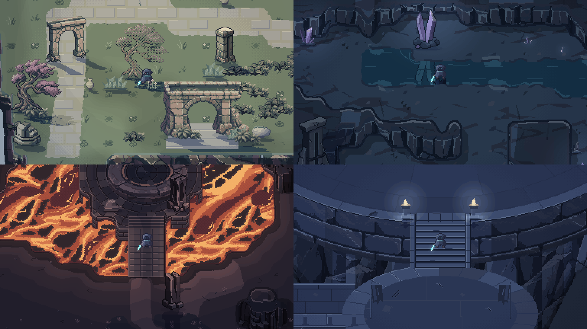
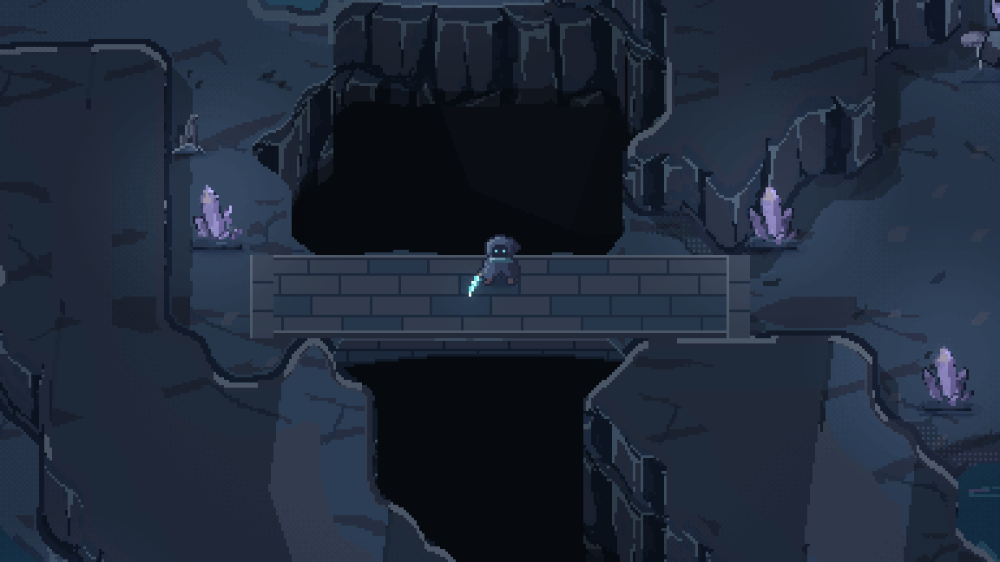
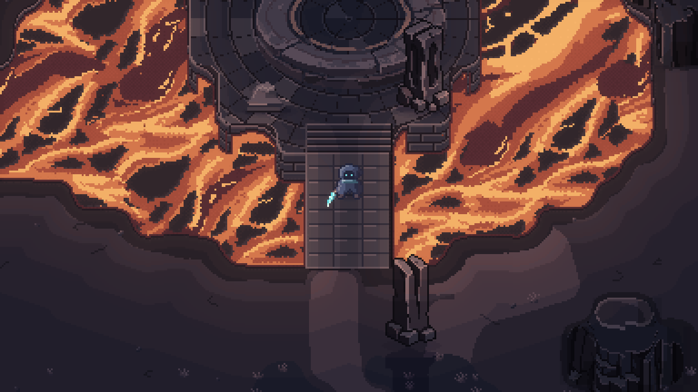

# GLINTBLADE

Created 2026-10-30 · Updated 2026-11-01

**This is AI slop.** I wanted to see the coolest game AI agents could come up with in one night, October 30-31, 2026. Agents, mostly Anthropic's Claude Opus 5.5 and OpenAI's GPT-6.1 Sol, wrote the code and drew the pixel art. The music came from AI music models, and the sound effects are Python synthesis with some AI-generated layers. My part was direction and feedback. I didn't write any code or draw any art.

**[Play it in your browser](https://pomykalakyle.github.io/glintblade/)**

[](docs/media/highlights.mp4)

Videos (60fps, with sound): [four-region samples](docs/media/highlights.mp4), [Cinder combat](docs/media/combat.mp4), [the Warden fight and ending](docs/media/warden_fight.mp4). These QA recordings use invulnerability for coverage.

The browser build includes the PixelLab art and normal-map lighting. WASD is the default;
touch devices also have on-screen controls. Click Play to enable sound.

GLINTBLADE is a short top-down pixel art action demo written in Rust. You play Glint, a small hooded wanderer with a crystal blade. You cross three floating regions to collect the shards of a cracked Prism, then climb to the Summit to fight the Warden, an old stone dam that woke up to guard it. The full-route review bot finishes in about four minutes.

## Why I made this

I want to see how good AI agents are at creative work like making video games, where the art is a big part of it. So I asked for "the most beautiful pixel art game you possibly can" and let them work until morning.

The first concept images from AI image models looked like slop, so the agents drew all the art in code instead, one pixel at a time. I gave feedback along the way, mostly on the art style and the lighting. Claude and GPT agents worked in parallel, building the game and reviewing each other's work.

The result is okay for a video game, but it didn't make me go "wow," and there are a lot of things in it I don't quite like artistically.

On November 1, I tried PixelLab's pixel-art models through MCP. The game now has
an environment pass across all four regions: Bloomwild's ruins and vegetation, Glasswater's
cave walls and crystals, Cinder's fractured foundry landscape, and the Summit's foundations,
piers and arena materials. The original maps, combat behavior and Warden animation remain.

The combined result was checked with matched native scene views, full-map overviews,
independent visual and code reviews, and a real-input walkthrough through all three shards
and the ending. Review fixes include foreground-tree visibility, native stone-base collision,
offscreen beam warnings and stray sky shadows. Recordings now use 60fps and synchronized
game audio. The automated full-route walkthrough uses invulnerability for coverage; it does
not establish ordinary-player difficulty balance. Source pixels and receipts are preserved
in `art/pixellab/2026-11-01/` and `art/pixellab/2026-11-01-round3/`.

A further contact and transition pass aligns trees and ruins with their visible bases,
keeps arch openings passable, and uses the actual painted terrain for cliff, water and lava
collision. Bridge decks now meet their banks, Bloomwild's turf joins the native rock, and
Glasswater has distinct shallows with smaller wakes and reflections. The title uses a complete
headland made with the same scenery. Cinder's molten surface carries a separately reviewed
PixelLab basalt-crust material through continuous currents. Independent reviews and reproducible contact checks
are recorded in [`art/pixellab/2026-11-01-round4/`](art/pixellab/2026-11-01-round4/).

The next landscape review gives that headland a continuous coast, joins cliff corners and
terrace ends, and replaces the Summit's dangling bridge piers with a supported shallow arch.
Bloomwild now mixes seven rooted tree shapes with fixed crowns and damaged columns with
complete beveled stone feet. Waterfalls use
narrow descending strands; Cinder uses a native PixelLab lava quilt with coherent canal flow.
Restrained moving daylight and local-source shadows survived lighting trials; a blotchy
Summit cloud treatment was rejected. Sources and review evidence are preserved in
[`art/pixellab/2026-11-01-round5/`](art/pixellab/2026-11-01-round5/).

The broader beauty pass replaces the earlier small enemy morphs with twelve full-animation
PixelLab designs: mushroom and camellia Sproutlings, birch and bracken Imps, geode and scallop
Beetles, moth and lantern Wisps, ivory and glassback Hounds, and copper and ceramic Totems.
All six archetypes keep their combat rules; each has three stable appearances across movement,
attacks, hurt, afterimages and debris. Every look appears in the authored encounters.
Bloomwild gains softer meadow light and singular ruined mosaics; Glasswater gains submerged
depth terraces and gentler crystal light; Cinder gains worn foundry beds; the Summit gains
radial observatory masonry. Sources, rejected studies and scoped independent reviews live in
[`art/pixellab/2026-11-01-round6/`](art/pixellab/2026-11-01-round6/).

The current lighting uses PixelLab normal maps for 78 native asset families. Bloomwild's
sun moves over a 36-second arc, shading ground foliage and casting moving native shadows.
Crystal sprigs lose their light when broken; Foundry banks respond to the actual hot lava
currents. The Warden's heart, fists and moving prisms light its body and nearby stone through
their animations. Native foot volumes keep column and character shadows attached.

The selected round 8 build completes all four regions through victory with the invulnerable
input pilot. Its release suite reports **254 passed, three performance-gate failures and seven
ignored**; all executed functional checks pass, but the old 6/8 ms rendering budgets remain
unmet. That release did not include a browser runtime check. The 78 normal families remain
frozen from round 7. This is a 2.5D renderer, with painted light retained in the art. Current
clips, source/build hashes, review scope and transfer instructions:
[`art/pixellab/2026-11-01-round8/`](art/pixellab/2026-11-01-round8/).

Round 9 rebalances Bloomwild's daylight across the title, cliffs, columns, trees, ground
plants and Glint. More sky/bounce fill and less direct sun retain detail in moving shadows
without brightening the sunlit paving. The other three regions match their round 8 scene
captures byte-for-byte. The release suite reports **255 passed, three existing performance
budget failures and seven ignored**. The browser player was exercised in an X-style sandbox
with keyboard and touch, including fullscreen denial and loading failures; this is not a
cross-device performance benchmark. Player Card metadata points at the existing GitHub
Pages game; actual X rendering still depends on the client and its card handling. Evidence:
[`art/pixellab/2026-11-01-round9/`](art/pixellab/2026-11-01-round9/).

## Screenshots

| | |
| --- | --- |
|  |  |
|  |  |
|  |  |
|  |  |
|  |  |

## Play

The easiest way is [in your browser](https://pomykalakyle.github.io/glintblade/). It works with a keyboard and mouse; gamepads only work in the desktop build.

To build it yourself, you need a recent stable Rust toolchain. The original desktop build ran on macOS (Apple Silicon). The PixelLab pass was also checked with Linux headless rendering and gameplay replays, plus a WebAssembly build.

```sh
cargo run --release
```

| Action | Keys |
| --- | --- |
| Move | W A S D or arrow keys |
| Slash (tap three times for a combo) | J / N, or left mouse |
| Spin slash | Hold J, then release |
| Dash | K / E or Space, or right mouse |
| Start | Enter or Space |
| Pause | Esc or P |
| Fullscreen | F |

N slash and E dash also work immediately after a fresh load. For Colemak-DH movement, press Tab on the title or pause screen: W/A/R/S move. The browser follows typed letters with both software and firmware layouts. The desktop option is `cargo run --release -- --colemak`. `--mute` turns the sound off. Gamepad support is built in, but no one has tried it with a real controller.

## How it was made

- Rust with [macroquad](https://github.com/not-fl3/macroquad) for the window, input and audio. The game draws into a 384x216 software framebuffer. The desktop scales by whole pixels; the browser fits the available space with nearest filtering and preserves the picture's proportions.
- The scripts the agents wrote to draw the art are in `tools/`.
- The four-region PixelLab source export is reproducible without API calls: `uv run --with pillow python tools/pixellab/build_assets.py`. Whole-game native studies use `python3 tools/pixellab/capture_world.py --tag <new-name>` after a release build; `tools/pixellab/record.py` records actual gameplay at 60fps.
- Lighting, cast shadows and glow are computed on the pixel grid.
- The soundtrack was generated with Google's Lyria 3.5 and ElevenLabs' Eleven Music through fal.ai. See [assets/music/NOTES.md](assets/music/NOTES.md) and [assets/sfx/NOTES.md](assets/sfx/NOTES.md) for how the music and sound effects were made.
- See [docs/ART_DIRECTION.md](docs/ART_DIRECTION.md) for the art direction and [docs/ART_RESEARCH.md](docs/ART_RESEARCH.md) for the pixel art research.

## Known issues

- The Bloomwild altar and some secondary props retain simpler first-night art. The Summit keeps its elliptical arena; Glasswater and the Summit remain deliberately dark.
- Verification is mostly scripted/headless; ordinary-player difficulty and the interactive sound mix still need human playtesting.

## License

MIT. See [LICENSE](LICENSE).
