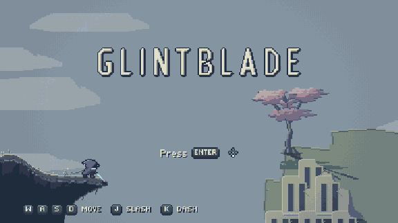
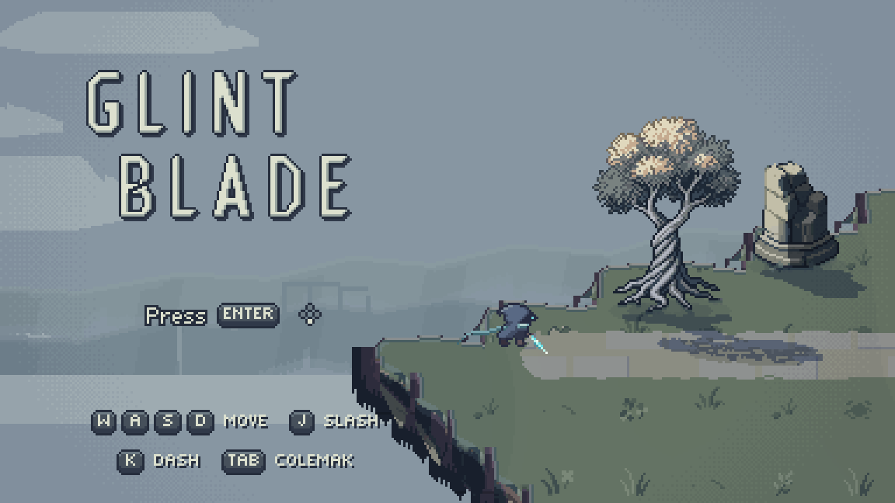
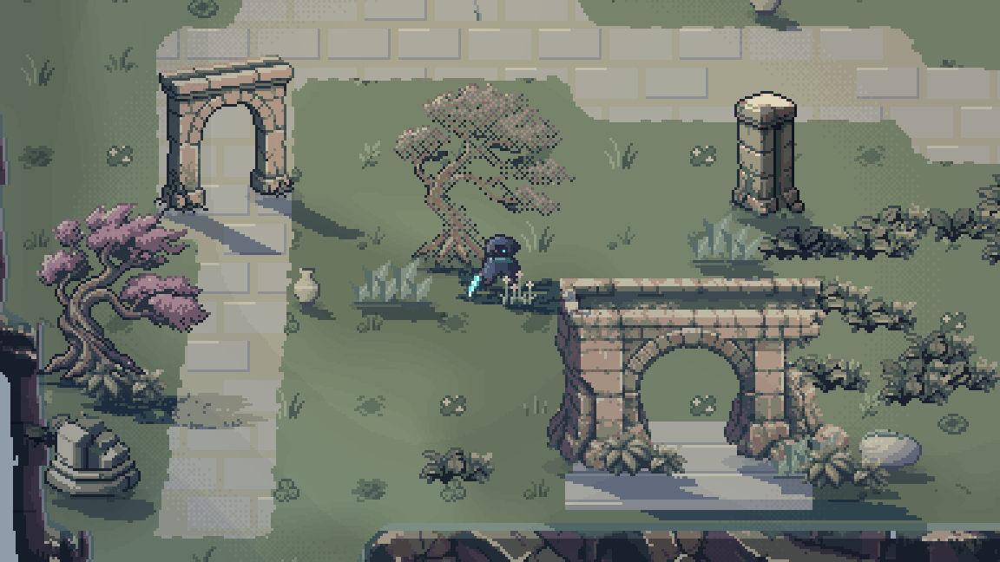
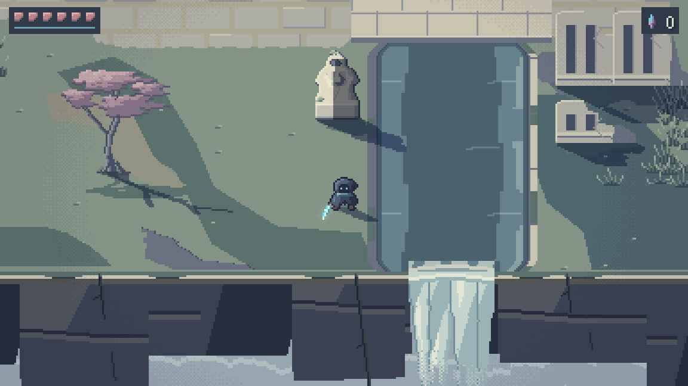
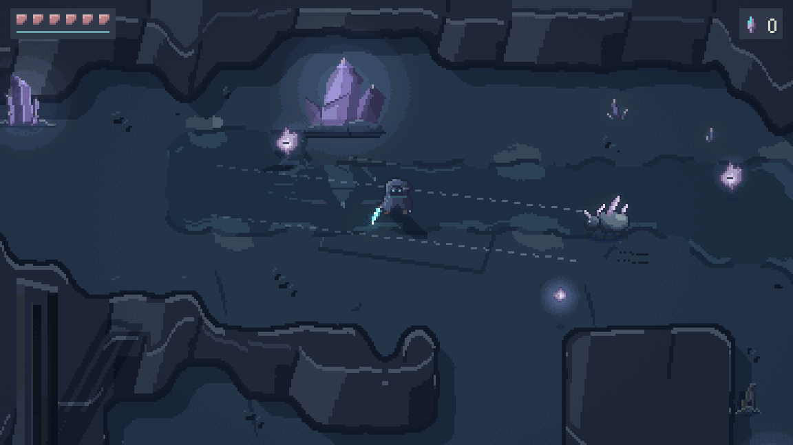
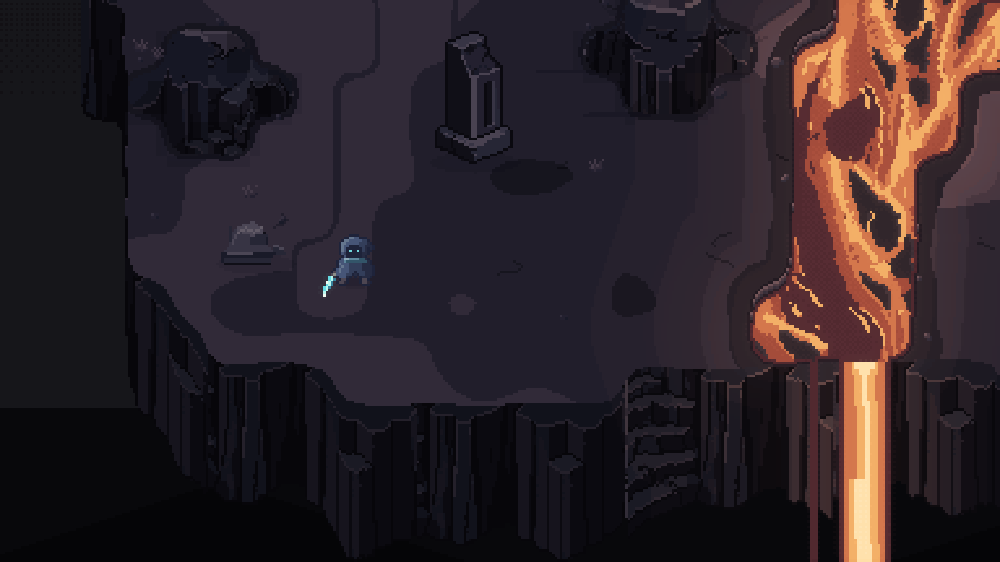
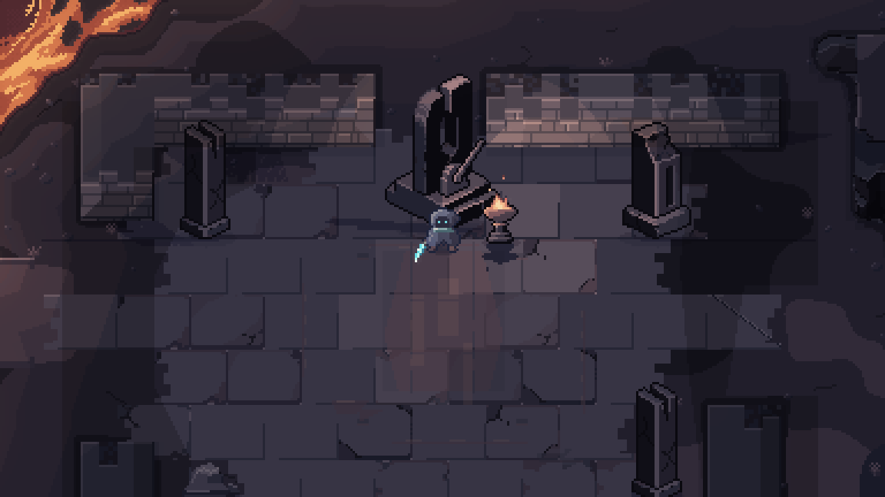
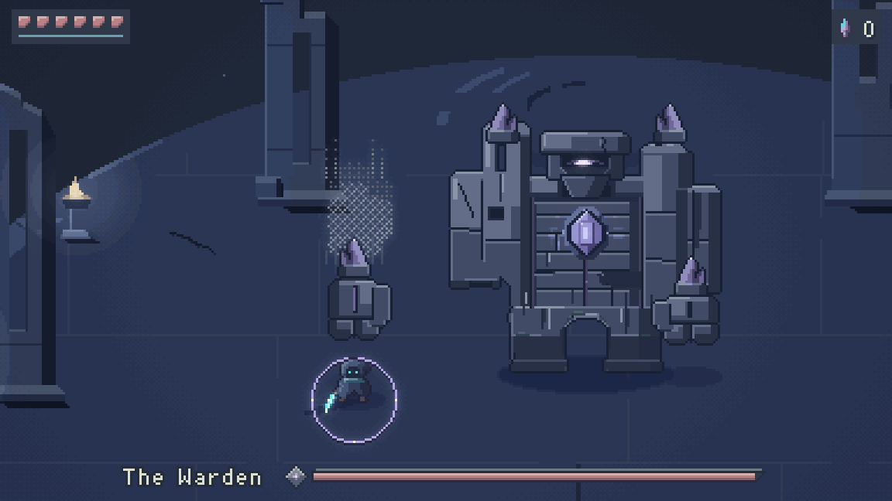
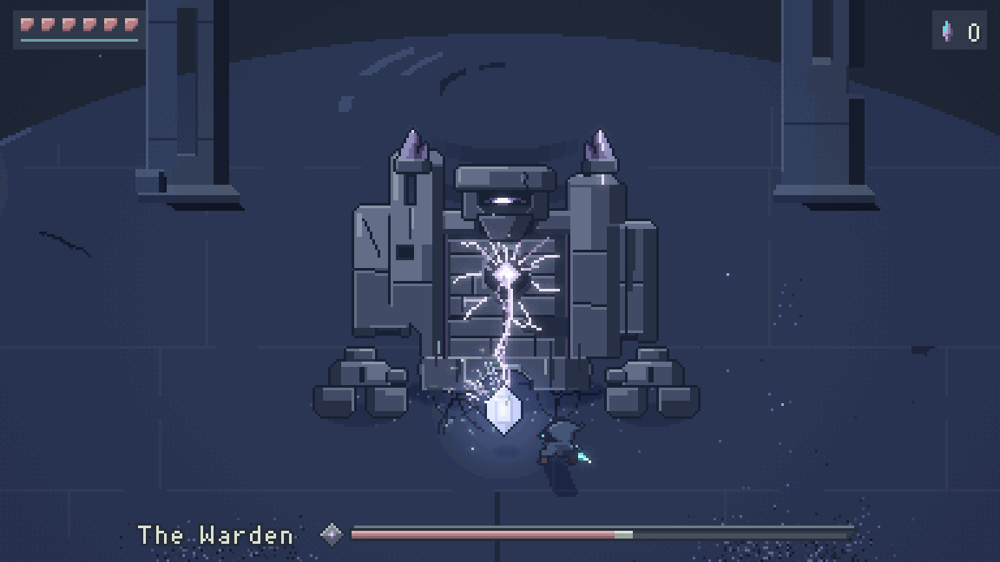

# GLINTBLADE

**This is AI slop.** I wanted to see how beautiful a pixel art game AI agents could make without it looking like AI slop, so I gave them one night, October 30-31, 2026. Agents, mostly Anthropic's Claude Opus 5.5 and OpenAI's GPT-6.1 Sol, wrote the code and drew the pixel art. The music came from AI music models, and the sound effects are Python synthesis with some AI-generated layers. My part was direction and feedback. I didn't write any code or draw any art.



Videos (no sound): [highlights](docs/media/highlights.mp4), [combat](docs/media/combat.mp4), [the Warden fight and ending](docs/media/warden_fight.mp4).

GLINTBLADE is a short top-down pixel art action demo written in Rust. You play Glint, a small hooded wanderer with a crystal blade. You cross three floating regions to collect the shards of a cracked Prism, then climb to the Summit to fight the Warden, an old stone dam that woke up to guard it. A bot that knows the route finishes in about three minutes.

## Why I made this

My first request was for "the most beautiful pixel art game you possibly can," and early on I told the agents, "The most important thing in this to me is probably making it look extremely good."

The early concept images from AI image models looked like AI slop to me and weren't real pixel art when I zoomed in, so none of them went into the game. I asked the agents to research what good pixel art looks like and what gives AI art away, and they drew all the art by writing code that places each pixel. When it started to look like Mario, I pointed them toward Hyper Light Drifter but asked for a style of its own. Later I asked whether the lighting was the problem, and they reworked it.

Claude and GPT agents worked in parallel through the night until 8 am, building the game and reviewing each other's work.

## Screenshots

| | |
| --- | --- |
|  |  |
|  |  |
|  |  |
|  |  |

## Play

You need a recent stable Rust toolchain. I've only run it on macOS (Apple Silicon) and haven't tried Linux or Windows.

```sh
cargo run --release
```

| Action | Keys |
| --- | --- |
| Move | W A S D or arrow keys |
| Slash (tap three times for a combo) | J, or left mouse |
| Spin slash | Hold J, then release |
| Dash | K or Space, or right mouse |
| Start | Enter or Space |
| Pause | Esc or P |
| Fullscreen | F |

For Colemak-DH, press Tab on the title or pause screen, or run `cargo run --release -- --colemak`. Then M N E I move, T slashes and S dashes. `--mute` turns the sound off. Gamepad support is built in, but no one has tried it with a real controller.

## How it was made

- Rust with [macroquad](https://github.com/not-fl3/macroquad) for the window, input and audio. The game draws into a 384x216 software framebuffer and scales it up by whole pixels.
- The scripts the agents wrote to draw the art are in `tools/`.
- Lighting, cast shadows and glow are computed on the pixel grid.
- The soundtrack was generated with Google's Lyria 3.5 and ElevenLabs' Eleven Music through fal.ai. See [assets/music/NOTES.md](assets/music/NOTES.md) and [assets/sfx/NOTES.md](assets/sfx/NOTES.md) for how the music and sound effects were made.
- See [docs/ART_DIRECTION.md](docs/ART_DIRECTION.md) for the art direction and [docs/ART_RESEARCH.md](docs/ART_RESEARCH.md) for the pixel art research.

## Known issues

- The title screen's lighting is flat, the south cliff faces repeat, and Glasswater and the Summit are a bit uniformly dark.
- Testing was mostly scripted and headless, so the sound mix hasn't had much listening.

## License

MIT. See [LICENSE](LICENSE).
